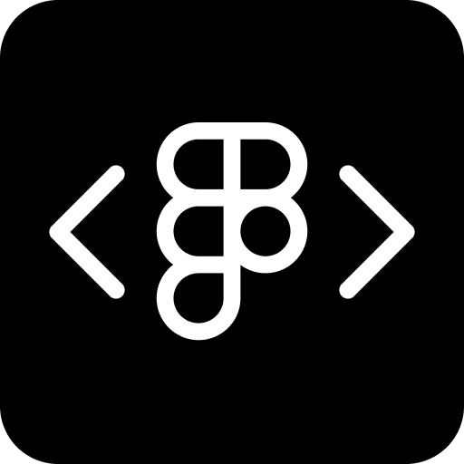

<div align="center">
  
  <h1>CodeFig</h1>
  <p><em>Run JavaScript inside Figma. Built for working with Variables, Styles, Design Systems, and Figma files and nodes programmatically.</em></p></br>
  
</div>


## What is CodeFig?

CodeFig is a script runner for Figma, inspired by the [Scripter plugin](https://www.figma.com/community/plugin/757836922707087381/Scripter) by **@rsms**. It ships a curated set of scripts for framing and auto-layout, style and variable batch operations, design-system foundations (colors, grid, typography, spacing, corner radius), and smaller workflow helpers.

Variables are a first-class use case, but CodeFig is broader than variable tooling. Scripts are plain JavaScript (ES2017) running in the Figma plugin sandbox.

**Why not Scripter?** Scripter introduced script-based automation in Figma and remains an excellent minimal tool. CodeFig adds scale, structure and reuse: a broader script set, a configuration form for each script, categories and search, `@import` between scripts, and no external dependencies.

**Perfect for** designers and engineers who want repeatable automation for layout, styles and variables, and design-system setup scripts in a self-contained plugin.


## Features

- Built-in code editor with keyboard shortcuts
- Script categories, search, import and export
- Prebuilt scripts and libraries, plus your own scripts with autosave
- **Configuration UI.** A script's settings become a form with fields, tabs, collection and mode pickers, a curve editor and a live preview. A `@PANEL_START` recipe next to the script's values defines it.
- `@import` for sharing functions between scripts and libraries
- Real-time console logging in dev mode

**Script storage and sharing**
- Scripts live in a `CodeFig Scripts` Variables collection, so they travel with the file and its published library. LocalStorage is kept as a personal backup. The settings gear turns each store on or off.
- Scripts from enabled remote libraries that publish `CodeFig Scripts` appear in their own sidebar folder.
- **Render on canvas** builds a page of script cards. Paste one into another file and the script appears in CodeFig there.
- Footer menus export to JSON or sync one script or all scripts to Variables.

> Only user scripts autosave. Prebuilt scripts are read-only, so duplicate one to edit it.


## Install

**From the Figma Community.** Install the plugin and open it in any Figma file.

**From GitHub.** Open the [latest release](https://github.com/marxcie/codefig/releases/latest) and download `codefig-vX.Y.Z-plugin.zip`. Unzip it, then in Figma choose **Plugins → Development → Import plugin from manifest…** and select the `manifest.json` next to `code.js` and `ui.html`.

**Quick start**
1. Open the plugin and pick a script in the sidebar.
2. Adjust its settings in the Configuration tab.
3. Run it with the Run button or `Cmd/Ctrl + R`.


## Bundled Scripts

Every script ships in the plugin, grouped in the sidebar as listed here.

### Utility Scripts

General tools for layout, selection and the Figma API.

| Script | Description |
|--------|-------------|
| **3D transform** | Rotates selected shapes around X, Y and Z with a field of view and pivot, and redraws them as vector outlines with true perspective. Optional copies along a direction and optional extrusion depth. |
| **Change case** | Renames canvas layers, components, variants, styles, and variables to a chosen case style (including hyphenated and ALL CAPS forms). |
| **Comments to annotations** | Reads Figma comments via the REST API and converts them into annotations. Useful when duplicating designs across files, as comments don't carry over. The script preserves comment positions by creating hidden anchors (since comments are usually attached to the root frame, not individual elements). Requires a Read Comments API token. |
| **Duplicate component** | Creates new definitions of selected components or component sets beside the originals. |
| **Frame or auto layout selected** | Wraps (or unwraps) each selected layer in new frames or auto-layout containers individually. |
| **Relink local component instances** | Relinks instances to the canonical local component when several definitions share the same name. |
| **Remove unnecessary nesting** | Detects and removes redundant wrapper frames (e.g. wrappers with only one child). Optionally normalizes wrappers (e.g. combining padding-x on wrapper 1 and padding-y on wrapper 2 into a single wrapper). |
| **Scale or resize elements** | Scales or resizes selected nodes by factor, ratio, or explicit dimensions (e.g. resize all selected to 16:9 with a width of 640px). |

### Styles

| Script | Description |
|--------|-------------|
| **Duplicate styles collection** | Duplicate a styles collection, with optionally rebinding its variable bindings to another collection. |
| **Rename styles** | Batch-renames styles using find/replace rules, similar to Figma's batch rename. |
| **Render styles overview** | Generates a visual overview of a defined style group in a frame. Primarily used to support Replace Styles, which requires all styles to exist in the file. The easiest approach is to generate the overview in the library file and paste it into the target file. |
| **Relink local styles** | Relinks layers to the canonical local style when several definitions share the same name. |
| **Replace styles** | Batch finds and rebinds node style assignments to different styles based on name matching and the local style inventory. Style replacement is less smooth than with variables due to limited Figma styles API support, so it requires a two-step approach. |
| **Text to styles** | Creates text styles from selected text layers, keeping variable bindings (if there are any). |

### Variables

| Script | Description |
|--------|-------------|
| **Duplicate variable collection** | Duplicates a variable collection with its metadata and values. |
| **Export / import variables** | Copies local variable collections between files as JSON. |
| **Match colors to collection variables** | Binds raw paint colors in the selection to COLOR variables from chosen collections. |
| **Copy or move variables** | Copies or moves variables between collections, per mode. A move rebinds every consumer in the file first, and refuses published sources. |
| **Rename variables** | Batch-renames variables using find/replace rules, similar to Figma's batch rename. |
| **Replace variables** | Batch finds and rebinds layer variable references or collections to another. |
| **Selection to variables** | Creates or updates variables from selected layers' names and values. |
| **Variable inspector *(WIP)*** | Inspects variable bindings and usage details in the file or selection. The goal is to find broken or outdated bindings and disconnected library artifacts. Still in progress due to the complexity. |

### Styles & Variables

| Script | Description |
|--------|-------------|
| **Check style–variable bindings** | Audits the selection for style and variable bindings that are not available in this file. |
| **Detach styles & variables** | Removes style and/or variable bindings from the current selection. You can choose which types to detach (fill, stroke, effect, typography, etc.) or remove all bindings. |
| **Replace variables in local styles** | Batch find and replaces variable bindings inside style definitions. |
| **Select by styles or variables** | Selects all nodes that use a specific style or variable. |

### Design System Foundations

These scripts let you build a highly configurable design system foundation with as many breakpoints as needed, and tune colors, spacing, grid, typography, and corner radius per breakpoint. Each panel stays empty until you pick a collection, then loads what the file already holds, previews the result before you run, and writes tokens in place so existing bindings survive.

| Script | Description |
|--------|-------------|
| **Colors** | Creates or updates a colour ramp per mode. HSL uses separate hue, saturation and lightness curves; OKLCH shares one lightness ladder with separate chroma and hue. Optional opacity variations written as aliases of the base colour. Loads an existing collection back into the panel. |
| **Corner radius** | Creates or updates corner radius variables across breakpoint modes and sets their respective scopes. Highly configurable: set min–max values and define as many steps, increment types, and naming conventions as needed. |
| **Grid** | Creates or updates layout grid variables across breakpoint modes, sets their respective scopes, suggests whole-number margin and gap pairs, creates grid styles for the setup, and generates preview frames with the grid setup. |
| **Spacing** | Creates or updates spacing variables across breakpoint modes and sets their respective scopes. Highly configurable: set min–max values per breakpoint and define as many steps, increment types, and naming conventions as needed. |
| **Typography** | Creates or updates typography variables across breakpoint modes with their respective scopes, and optionally matching text styles. Highly configurable: set min–max values per breakpoint and define as many steps, increment types, and naming conventions as needed. |

### Importable Libraries

Libraries are `@`-prefixed scripts that other scripts pull functions from with `@import`. They are not run directly.

| Library | Description |
|---------|-------------|
| **@Core Library** | General utility helpers for node traversal, styles, colors, and shared low-level operations. |
| **@CodeFigUI** | Helpers for building script config UIs inside CodeFig. |
| **@InfoPanel** | Utilities for showing structured results in the plugin UI. |
| **@Math Helpers** | Math and scaling helpers for interpolation, easing, ratios, and generated scales. |
| **@Pattern Matching** | Shared pattern and wildcard matching utilities. |
| **@Replacement Engine** | Core logic for planning and applying find/replace operations. |
| **@Rename Preview** | Previews find/replace renames with collision flags before writing. |
| **@Styles** | Helpers for discovering, analyzing, and replacing styles. |
| **@Variables** | Helpers for collections, variables, bindings, and value updates. |
| **@Bezier**, **@Scale Models**, **@Linear Ramp**, **@Type Scale** | Curve maths and the number sequences behind the Spacing, Corner radius and Typography scales. |
| **@OKLCH**, **@Color Ramp** | Colour conversion and ramp generation behind Colors. |
| **@Foundation**, **@Foundation overview** | Design System Foundations manifests, set identity, and Overview frames. |
| **@Test Harness** | Runs in-Figma specs against the real API (development). |

**Your own scripts:** create a script and run it. Name one with an `@` prefix (for example `@My Utils`) and it becomes a library other scripts can import.


## Keyboard Shortcuts

| Shortcut | Action |
|----------|--------|
| `Cmd/Ctrl + R` | Run script |
| `Cmd/Ctrl + /` | Toggle line comments in the editor |
| `Cmd/Ctrl + E` | Export script |
| `Cmd/Ctrl + I` | Import script |
| `Cmd/Ctrl + N` | New script |

User scripts autosave after you pause typing — there's no separate Save shortcut.


## Network & Privacy

CodeFig is self-contained.
- No CDNs, third-party services or telemetry
- Uses the Figma API only when a script requires it (for example Comments to annotations)
- Runs entirely in the Figma plugin sandbox

`http://localhost:8765` appears only in dev builds, for console log forwarding.


## Development

```
npm install
npm run dev
```

`npm run dev` builds, watches `src/` and `scripts/`, and starts the console log server, which writes to `figma-console.log`. Import `dist/manifest.json` in Figma (**Plugins → Development → Import plugin from manifest…**) and reload the plugin after each rebuild. The manifest is generated, so it does not exist until the first build.

### Project structure

| Path | Contents |
|------|----------|
| `src/` | Sandbox code (`code.ts`, the only TypeScript), UI (`ui.html`, `ui.css`), config UI, import resolver, and the `manifest.json` template |
| `scripts/EXAMPLE_SCRIPTS/` | Bundled scripts. Subfolders become sidebar groups |
| `scripts/CODEFIG_LIBRARIES/` | Importable `@` libraries |
| `scripts/HELP/` | Help and documentation script |
| `scripts/_TESTS/` | In-Figma specs, never shipped |
| `tests/` | Node fixture tests |
| `dist/` | Build output (`manifest.json`, `code.js`, `ui.html`), gitignored |

Files and folders whose names start with `_` or `.` are never shipped. See [scripts/README.md](scripts/README.md) for script conventions and the `@import` system.

### Commands

| Command | Description |
|---------|-------------|
| `npm run dev` | Dev build, watch, and console log server |
| `npm run build:dev` | Dev build. Validation only warns, so half-written scripts still build |
| `npm run build:production` | Production build. A validation error fails it. No `localhost` in the manifest |
| `npm run validate` | Parses every script as the sandbox does and checks that `@import`s resolve |
| `npm test` | Node fixture tests, no Figma needed |
| `npm run test:figma` | Runs the in-Figma specs against the open plugin |
| `npm run figma:run -- <script>` | Runs a script inside the open plugin from the terminal |
| `npm run figma:sync` | Waits until the open plugin reports the current dev build |
| `npm run figma:ui -- <command>` | Drives the plugin UI from the terminal (dev builds only) |
| `npm run bench:colors` | Measures how closely Colors reproduces real colour scales |
| `npm run build:style-reference` | Regenerates `artifacts/style-reference.html` |
| `npm run preview:panel -- "<script>"` | Renders a script's Configuration UI in a browser |
| `npm run pack` | Production build plus `codefig-plugin.zip` |
| `npm run build:release -- patch\|minor\|major` | Release build, version bump, commit and tag |

The full command notes and architecture live in [CLAUDE.md](CLAUDE.md). Open work is tracked in [ROADMAP.md](ROADMAP.md) and [DEFERRED.md](DEFERRED.md), and user-facing changes in [CHANGELOG.md](CHANGELOG.md).

### Releasing

```
npm run build:release -- patch
```

Use `minor` or `major` as needed. The command requires a clean working tree, runs a production build and pack, bumps the version, and makes one commit and a `v*` tag. It does not push unless you pass `--push`. `--dry-run` builds and packs only.

Pushing the tag starts `.github/workflows/release.yml`. It validates, tests and builds, then attaches `codefig-vX.Y.Z-plugin.zip` to the GitHub release. The zip is never committed.

If the release script fails with *tag already exists*, a previous run created the tag without finishing. Delete it with `git tag -d <tag>` and retry.


## Contributing

- Open issues for bugs or proposals
- Submit pull requests
- Share reusable scripts


## License

MIT, free for commercial and non-commercial use.
